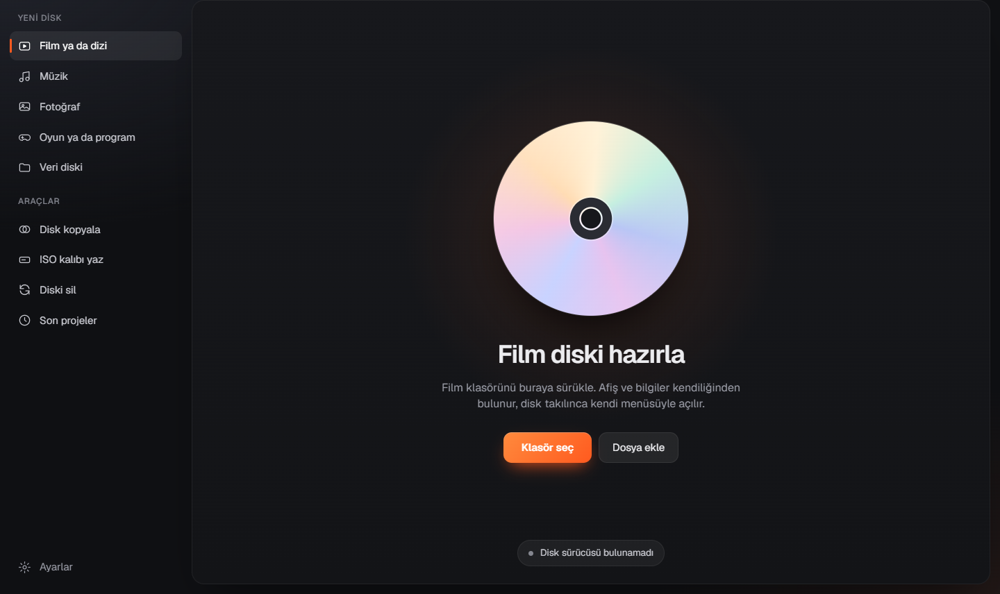
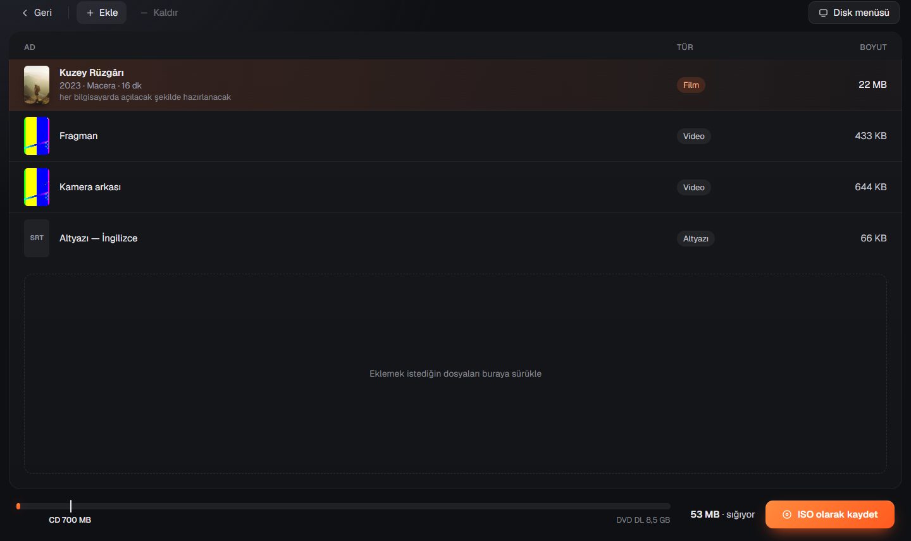
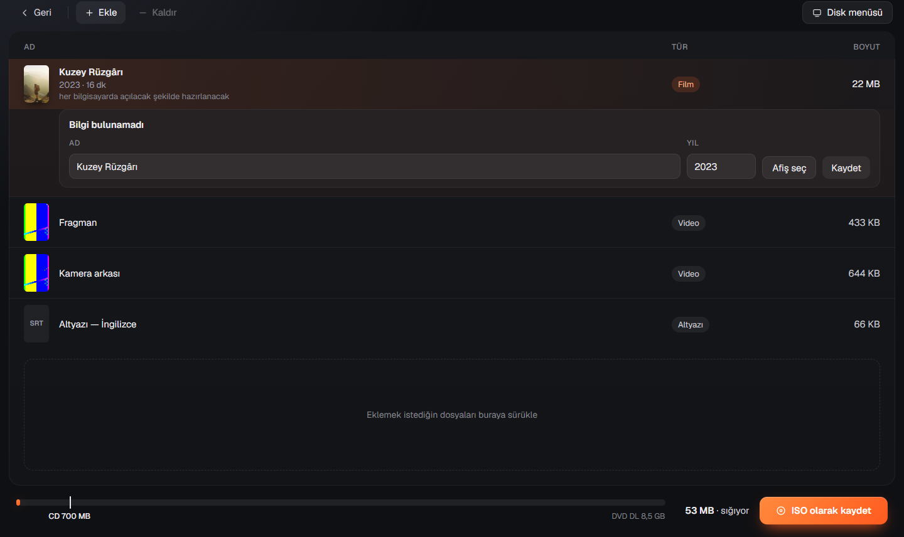
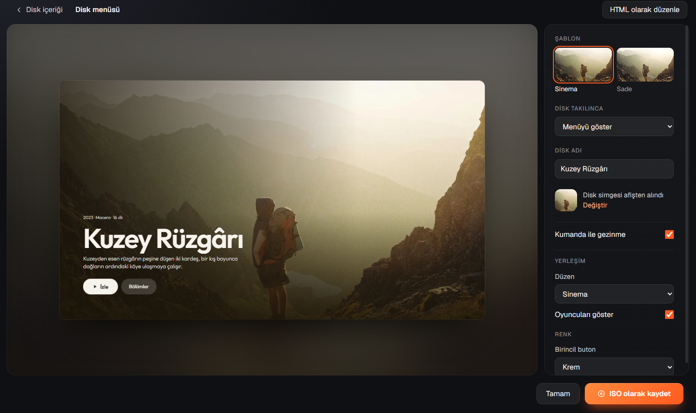
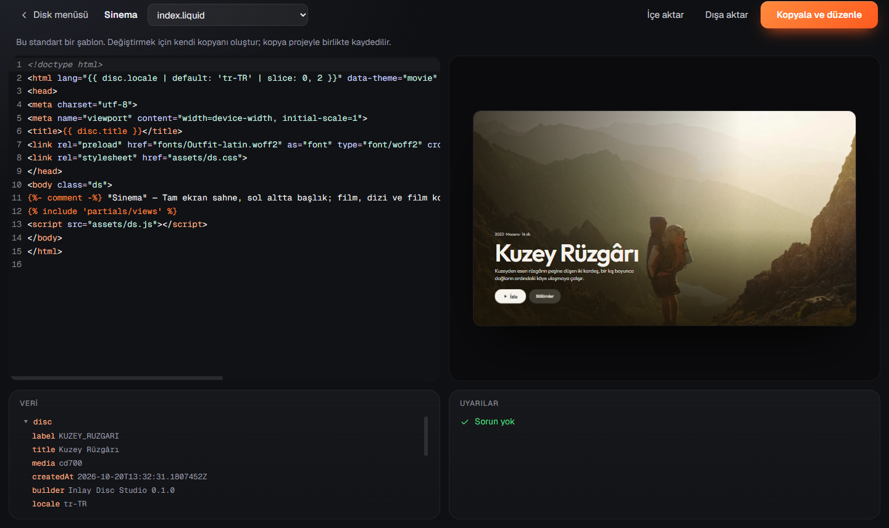
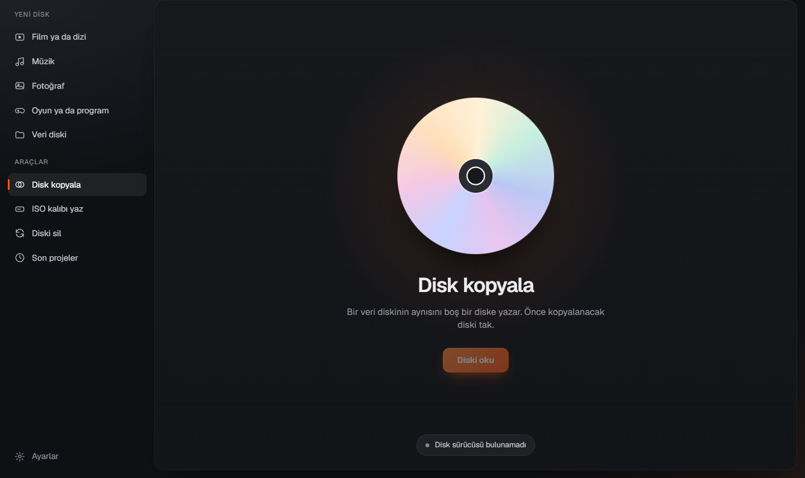
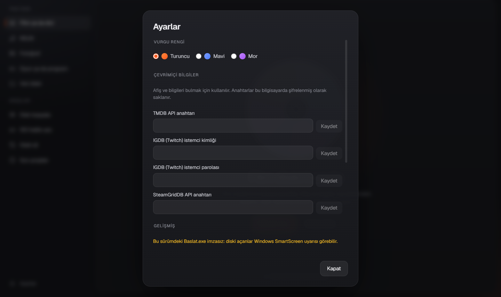

# Inlay Disc Studio — Kullanım Rehberi

Inlay, film, müzik, fotoğraf, oyun ya da program klasörlerinden **kendi menüsüyle açılan** CD ve DVD'ler hazırlar.
Diski takan kişi bir programla uğraşmaz: afişler, kapaklar ve fotoğraflar tam ekran gelir, tek tuşla izler, dinler
ya da kurar. Bu rehber diskin hazırlanmasını adım adım anlatır.

## 1. Başlangıç

1. Soldaki **Yeni disk** listesinden ne hazırladığını seç: *Film ya da dizi*, *Müzik*, *Fotoğraf*, *Oyun ya da
   program* ya da *Veri diski*. Seçim yalnızca başlığı ve açıklamayı değiştirir. Klasörü bırakınca Inlay içeriği
   kendisi tanır ve listedeki seçim kendiliğinden değişir.
2. Klasörü panelin herhangi bir yerine sürükle ya da **Klasör seç**'e bas (kısayol **Ctrl+O**). Tek tek dosya
   eklemek için **Dosya ekle**.
3. Alttaki kapsül sürücünün durumunu gösterir: yeşil nokta ve "Boş DVD-R, 4,7 GB" gibi bir yazı, diske yazmaya
   hazır olduğu anlamına gelir. Gri nokta, sürücüde disk olmadığını gösterir.

Daha önce kaydettiğin projeler **Son projeler**'de durur.

## 2. Disk içeriği

Inlay klasörü incelerken içerik tabloda belirir. Afiş, yıl, tür ve süre film klasöründeki `.nfo` dosyasından ya
da (Ayarlar'da anahtar girildiyse) TMDB'den bulunur. Filmin fragmanı, ekstraları ve altyazıları filmin altında
ayrı satırlarda görünür.

- **Türü düzelt:** Bir satıra sağ tıklayıp doğru türü seç (ör. "Bu aslında Dizi").
- **Kaldır:** Satırı seçip **Kaldır**'a ya da **Delete** tuşuna bas.
- **Yeniden adlandır:** Satırı seçip **F2**'ye bas.
- **Ekle:** Yeni dosyaları alttaki kesik çizgili alana sürükle.
- Satırdaki gri not ("her bilgisayarda açılacak şekilde hazırlanacak") dosyanın yazmadan önce her bilgisayarda
  oynayacak biçime getirileceğini söyler. Senin bir şey yapman gerekmez.

**Bu film hangisi?** Inlay bir filmden emin olamazsa satırın altında küçük bir kart açar. Ya önerilerden birini
seçersin ya da **Bilgileri kendim yazacağım** ile adı, yılı ve afişi kendin girersin. Hiçbir bilgi bulunamazsa
kart doğrudan bu alanlarla açılır.

**Doluluk cetveli:** Alttaki çubuk içeriğin ne kadar yer tuttuğunu CD (700 MB), DVD (4,7 GB) ve DVD DL (8,5 GB)
işaretleriyle gösterir. İçerik sığmazsa çubuk sarıya döner ve öneriler çıkar: "DVD DL kullan", "Fragmanı çıkar
(−86 MB)" gibi. Bir öneriye basman yeterli.

## 3. Disk menüsü

Soldaki büyük önizleme, diski takan kişinin göreceği menünün kendisidir. Tıklayıp klavyeyle gezebilirsin.

- **Şablon:** Görselli kartlardan birini seç (ör. *Sinema* ya da *Sade*).
- **Disk takılınca:** *Menüyü göster* ya da *Filmi hemen oynat* (albümde "Albümü hemen çal", fotoğrafta "Slayt
  gösterisini başlat").
- **Disk adı:** Menüde ve Windows Gezgini'nde görünen ad.
- **Disk simgesi:** Gezgin'de disk için görünen simge. Varsayılan olarak afişten yapılır; **Değiştir** ile kendi
  resmini ya da `.ico` dosyanı seçebilirsin.
- **Kumanda ile gezinme:** Açıksa menü oyun kolu ve kumandayla da gezilir.
- Aşağıda şablonun kendi ayarları (renkler, düzen) ve **Bölümler** vardır. Bölümleri sürükleyerek (ya da
  Alt+↑/↓ ile) sıralayabilir, adlarını değiştirebilir, gizleyebilirsin.

> **Windows 10/11'de diskler kendiliğinden başlamaz.** Disk takılınca Windows bir bildirim gösterir; ona
> tıklayınca "Filmi izle" ya da "Menüyü aç" gibi seçenek çıkar. Disk Gezgin'den çift tıklanarak da açılır. Bu,
> Windows'un güvenlik kuralıdır; Inlay'in yapabileceği bir şey yoktur.

## 4. HTML olarak düzenle (isteğe bağlı)

Menüyü HTML ve Liquid ile tamamen kendin şekillendirmek istersen **HTML olarak düzenle**'ye bas. Standart
şablonlar korunur. Önce **Kopyala ve düzenle** ile kendi kopyanı oluşturursun, kopya projeyle birlikte kaydedilir.

- Sol tarafta kod, sağda canlı önizleme vardır. Yazdıkça önizleme güncellenir.
- **Veri** panelindeki bir alana tıklamak, onu `{{ items['…'].title }}` biçiminde koda ekler.
- **Uyarılar** paneli hataları gösterir. **Hata varken disk yazılamaz**; ör. diske internetten resim çekmeye
  çalışan bir etiket hata sayılır, çünkü disk menüsü internete bağlanmaz.
- **Dışa aktar / İçe aktar** ile şablonu `.disctheme` dosyası olarak paylaşabilirsin.

Şablon yazmanın ayrıntıları için: [theme-authoring.md](theme-authoring.md).

## 5. Diske yaz

- **Diske yaz:** Sürücüde boş ve yeterince büyük bir disk varsa birincil düğme budur (kısayol **Ctrl+B**).
- **Disk tak:** Sürücüde disk yoksa ya da takılı disk küçükse düğme bu olur ve tepsiyi açar.
- **ISO olarak kaydet:** Diski hemen yazmak yerine bir disk kalıbı dosyası oluşturur. Bu kalıp sonra yazılabilir
  ya da Windows'ta çift tıklanarak denenebilir.

Yazarken bir pencere ilerlemeyi, kalan süreyi ve yazma hızını gösterir. **Bitince kontrol et ve diski çıkar**
işaretliyse Inlay, yazma bitince diskteki her dosyayı geri okuyup asıllarıyla karşılaştırır, sonucu ve okuma
hızı grafiğini gösterir, ardından diski çıkarır. **Bir kopya daha** aynı diski dosyaları yeniden hazırlamadan
tekrar yazar.

Bir sorun olursa pencere sakin bir açıklama yapar: "Sürücüde disk yok", "Takılı disk boş değil", "Bu içerik
takılı diske sığmıyor", "Veriler sürücüye yeterince hızlı ulaşmadı…" gibi. Son durumda Ayarlar › Gelişmiş'ten
daha yavaş bir hız seç.

## 6. Araçlar

- **Disk kopyala:** Bir veri diskinin aynısını boş bir diske yazar. Önce kopyalanacak diski tak ve **Diski oku**'ya
  bas; okuma bitince tepsi açılır. Boş disk tak, **Diske yaz**. (Müzik CD'leri, DVD-Video ve kopya korumalı diskler
  kopyalanmaz.)
- **ISO kalıbı yaz:** Hazır bir `.iso` dosyasını boş bir diske yazar.
- **Diski sil:** Yeniden yazılabilir bir diskin (CD-RW, DVD-RW) içeriğini siler. Onay istenir.

## 7. Ayarlar

- **Vurgu rengi:** Turuncu, mavi ya da mor.
- **Çevrimiçi bilgiler:** TMDB (film ve dizi), IGDB (oyun) ve SteamGridDB (oyun görselleri) anahtarları. Bu
  anahtarlar yalnızca bu bilgisayarda, Windows'un şifreli deposunda saklanır. Anahtar girmesen de Inlay çalışır:
  bilgileri `.nfo` dosyalarından, Steam mağazasından ya da senin girdiklerinden alır.
- **Gelişmiş:** Orijinalleri koruma, maksimum uyumluluk, video kodlayıcı, UDF revizyonu, sürücü seçimi, yazma
  hızı ve yazdıktan sonra doğrulama.

## 8. Proje dosyası

Inlay her değişikliği kendiliğinden kaydeder. **Ctrl+S** projeye bir ad ve yer verir (`.discproj`). Proje
dosyası kaynak klasörlerin yerini, düzeltmelerini, şablon seçimini ve kendi şablonunu saklar. Klasörü başka
bir yere taşıdıysan proje açılınca **Yerini göster** ile yeni yerini göstermen yeterli. Geri almak için
**Ctrl+Z**, yinelemek için **Ctrl+Y**.

## 9. Diski takan kişi ne görür?

- Disk menüsü tam ekran ve sadedir. Ok tuşları, Enter ve Esc ile ya da fareyle gezilir.
- Filmler kaldığı yerden devam eder. Altyazı ve ses dili oynatıcıdan seçilir.
- Oyun ve programlar tek tuşla kurulur. Bilgisayarın yeterli olup olmadığı (bellek, boş yer) menüde yazar.
- Bilgisayarda WebView2 yoksa disk, tarayıcıda açılan sade bir menüyle (`Menu.html`) yine kullanılabilir.
